# My House — Software Architecture Document

> **Standard :** arc42 (adapté)
> **Version :** 1.8
> **Statut :** Validé
> **Dernière mise à jour :** Novembre 2026

---

## Table des Matières

1. [Introduction et Objectifs](#1-introduction-et-objectifs)
2. [Contraintes](#2-contraintes)
3. [Contexte et Périmètre](#3-contexte-et-périmètre)
4. [Stratégie de Solution](#4-stratégie-de-solution)
5. [Vue des Blocs Fonctionnels](#5-vue-des-blocs-fonctionnels)
6. [Vue Runtime — Flux Critiques](#6-vue-runtime--flux-critiques)
7. [Vue Déploiement](#7-vue-déploiement)
8. [Concepts Transverses](#8-concepts-transverses)
9. [Décisions d&#39;Architecture](#9-décisions-darchitecture)
10. [Exigences de Qualité](#10-exigences-de-qualité)
11. [Risques et Dette Technique](#11-risques-et-dette-technique)
12. [Glossaire](#12-glossaire)

---

## 1. Introduction et Objectifs

### 1.1 Objectif du Système

**My House** est une plateforme web de mise en relation entre propriétaires immobiliers et personnes en recherche de logement (maisons, studios, appartements, chambres). Elle couvre le cycle complet : publication de biens → recherche → prise de contact.

### 1.2 Objectifs de Qualité

| Priorité | Objectif                  | Motivation                                                                                  |
| --------- | ------------------------- | ------------------------------------------------------------------------------------------- |
| 1         | **Fiabilité**      | Les annonces publiées doivent être disponibles en permanence — c'est le cœur du service |
| 2         | **Sécurité**      | Authentification sans mot de passe, protection des données de contact des propriétaires   |
| 3         | **Maintenabilité** | Codebase évolutif du MVP vers V2 sans refactoring majeur                                   |
| 4         | **Performance**     | Recherche < 500ms, chargement feed < 2s                                                     |
| 5         | **Utilisabilité**  | Parcours minimal pour publier un bien et pour contacter un propriétaire                    |

### 1.3 Parties Prenantes

| Partie Prenante                       | Rôle              | Intérêt Principal                                         |
| ------------------------------------- | ------------------ | ----------------------------------------------------------- |
| **Owner** (Propriétaire)       | Utilisateur final  | Publier et gérer ses biens, être contacté                |
| **Seeker** (Visiteur/Chercheur) | Utilisateur final  | Trouver un logement, contacter un propriétaire             |
| **Admin**                       | Opérateur interne | Modérer la plateforme, valider les demandes propriétaires |
| **Équipe de développement**   | Constructeur       | Architecture claire, dette technique maîtrisée            |

---

## 2. Contraintes

### 2.1 Contraintes Techniques

| Contrainte                         | Détail                                                                                                                                                      |
| ---------------------------------- | ------------------------------------------------------------------------------------------------------------------------------------------------------------ |
| Backend en Rust                    | Décision non négociable — stack imposée                                                                                                                  |
| Base de données relationnelle     | Les données (biens, utilisateurs, médias) sont fortement structurées et relationnelles                                                                    |
| Authentification sans mot de passe | OTP par email uniquement au MVP — pas d'OAuth                                                                                                               |
| Stockage fichiers (MVP)            | Filesystem local via volume Docker. Abstraction`StorageProvider` obligatoire pour migrer vers un stockage S3-compatible (V2) sans modifier le code métier |
| Pas de Redis au MVP                | Cache in-memory uniquement (moka)                                                                                                                            |
| Environnement local conteneurisé  | Docker obligatoire pour garantir la parité dev/prod                                                                                                         |

### 2.2 Contraintes Organisationnelles

| Contrainte         | Détail                                                                          |
| ------------------ | -------------------------------------------------------------------------------- |
| MVP d'abord        | Aucune feature V2 (messagerie, carte, push, favoris) dans le périmètre initial |
| Conformité RGPD   | Différée à la phase pré-production — non bloquante pour le MVP              |
| Application mobile | Différée à V2 — web uniquement au MVP                                        |

---

## 3. Contexte et Périmètre

### 3.1 Contexte Métier

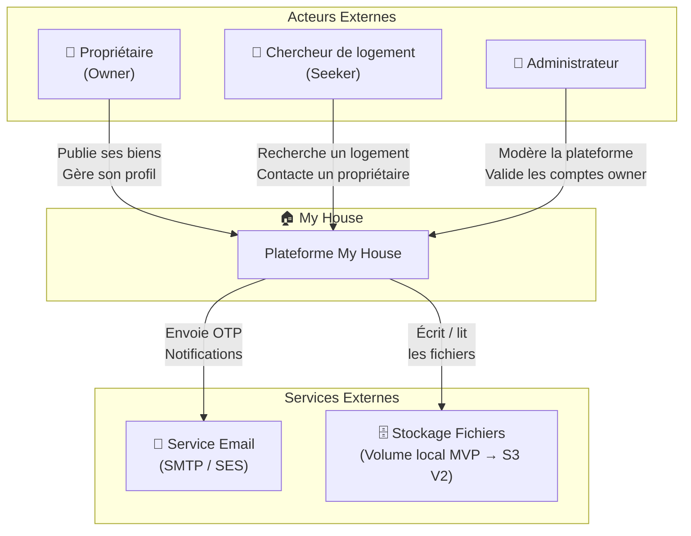

### 3.2 Contexte Technique

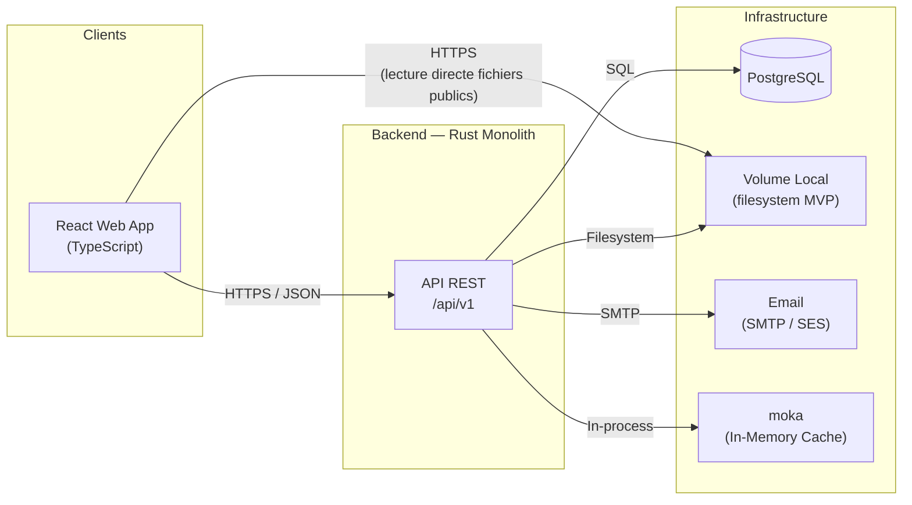

**Note :** le frontend lit les fichiers publics (photos de listings, avatars) directement depuis le volume servi en statique — le backend n'intervient pas dans cette lecture (cf. §7.3). L'écriture (upload) et les documents d'identité sensibles passent exclusivement par l'API.

**Interfaces externes du système :**

| Interface                  | Protocole                      | Direction      | Usage                                                             |
| -------------------------- | ------------------------------ | -------------- | ----------------------------------------------------------------- |
| React Frontend → Backend  | HTTPS / REST JSON              | Bidirectionnel | Toutes les interactions utilisateur                               |
| Backend → PostgreSQL      | TCP / SQL (sqlx)               | Sortant        | Persistence des données                                          |
| Backend → Object Storage  | Filesystem (MVP) / S3 API (V2) | Sortant        | Écriture des médias — abstraction`StorageProvider`           |
| Frontend → Object Storage | HTTPS (statique)               | Sortant        | Lecture directe des fichiers publics (sans passer par le backend) |
| Backend → Email           | SMTP / SES API                 | Sortant        | OTP, notifications transactionnelles                              |
| Backend → moka            | In-process                     | Interne        | Cache OTP et sessions temporaires                                 |

---

## 4. Stratégie de Solution

### 4.1 Pattern Architectural Central : Modular Monolith

Un seul binaire déployé, structuré en modules de domaine aux frontières strictes. Chaque module encapsule sa propre logique métier, ses accès données et ses interfaces HTTP.

**Justification :**

- Cible 10K–100K utilisateurs : bien dans la zone de confort d'un monolithe optimisé
- Équipe réduite : pas d'overhead opérationnel microservices
- Rust enforce les frontières inter-modules à compile-time
- Extraction future en services indépendants possible sans refactoring majeur — les interfaces de domaine sont déjà propres

### 4.2 Layering Interne

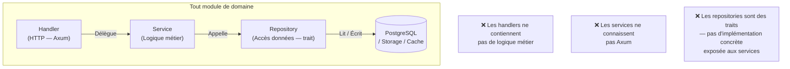

### 4.3 Stack Technique

| Couche                | Technologie                             | Justification                                                                    |
| --------------------- | --------------------------------------- | -------------------------------------------------------------------------------- |
| Backend               | Rust / Axum / Tokio                     | Async-first, sécurité mémoire, performances natives                           |
| Frontend              | React / TypeScript                      | Productivité, typage fort, web-first MVP                                        |
| Base de données      | PostgreSQL                              | ACID, full-text search natif (tsvector), relationnel                             |
| Cache                 | moka (in-memory)                        | OTP éphémère sans dépendance Redis                                           |
| Stockage médias      | Filesystem local (MVP) → MinIO/S3 (V2) | Abstraction trait`StorageProvider`, migration sans refactoring du code métier |
| Génération types TS | utoipa → openapi-typescript            | Contrat API unique source de vérité                                            |
| Conteneurisation      | Docker / docker-compose                 | Parité dev/prod, onboarding simplifié                                          |

---

## 5. Vue des Blocs Fonctionnels

### 5.1 Niveau 1 — Vue Système

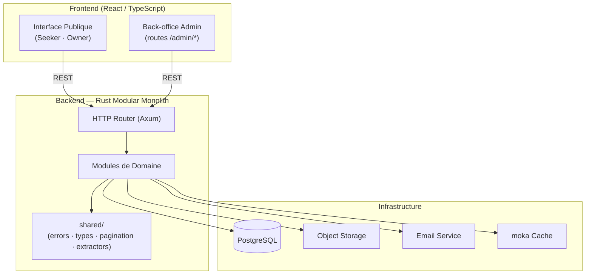

### 5.2 Niveau 2 — Modules de Domaine

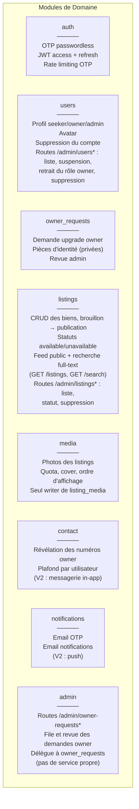

La recherche n'est pas un module : `listings` sert le feed et `GET /search` avec les mêmes filtres, la même règle de visibilité et les mêmes requêtes (ADR-12).

Les routes admin de modération sont dans le module qui possède les données : `/admin/listings*` dans `listings`, `/admin/users*` dans `users` (ADR-13). Le module `admin` ne contient plus que les routes des demandes owner.

### 5.3 Dépendances Inter-Modules

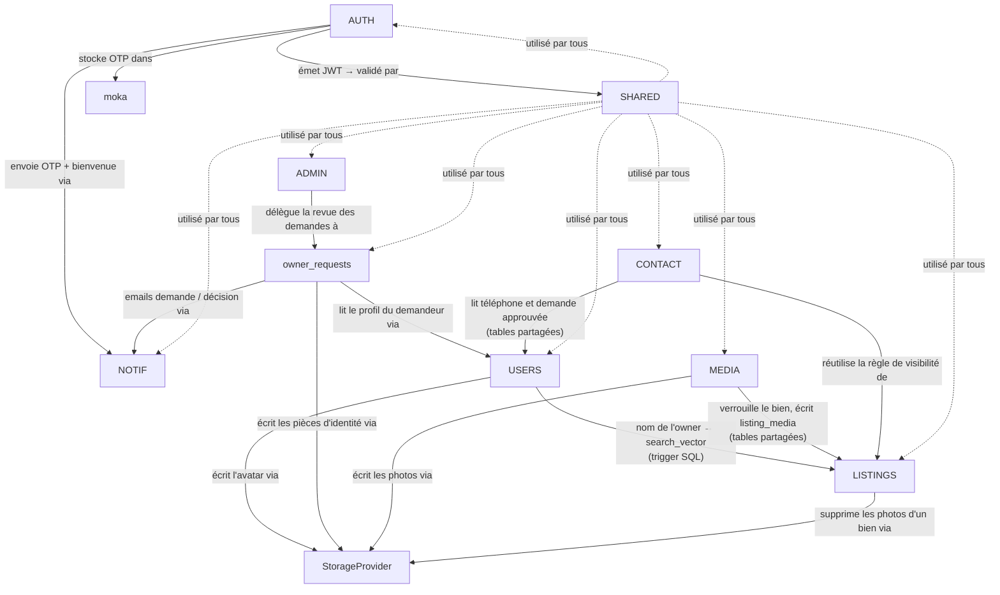

**Règle de dépendance :** les modules interagissent uniquement via des traits de service définis dans `shared/` ou via injection au bootstrap. Aucun module n'importe jamais l'implémentation concrète d'un autre. Cinq écarts existent aujourd'hui (`owner_requests` → `users`, `admin` → `owner_requests`, `auth` / `owner_requests` → `notifications`, `contact` → `listings::repository`, et `shared::extractors` → `users::repository`) ; ils sont suivis en R-11 (§11).

`users`, `listings` et `media` n'importent aucun autre module mais partagent des tables : `listings` lit `listing_media` (cover, visibilité) et `users` (owner actif au rôle `owner`, visibilité), `users` compte les lignes `listings` de chaque compte pour le back-office, `media` verrouille la ligne `listings` avant d'écrire une photo, et `users` lit les clés de `listing_media` et de `owner_requests.identity_documents` pour nettoyer le storage à la suppression d'un compte. Changer la forme JSONB de `identity_documents` impose donc de revoir aussi cette lecture. L'upload passe par les helpers partagés `shared::file_validation` et `shared::storage_key` ; chaque module appelle ensuite `StorageProvider` lui-même (TECHNICAL_SPEC_MVP.md §3.1).

---

## 6. Vue Runtime — Flux Critiques

### 6.1 Authentification OTP — Login et Inscription Unifiés

Le même endpoint d'entrée gère login et inscription, et le frontend est routé par `is_new_user: bool`. La création de compte, elle, est une transaction unique portée par `POST /auth/register` : `/auth/otp/verify` n'écrit rien en base pour un email inconnu, il délivre un `registration_ticket` opaque (UUID v4, usage unique, TTL 10 min, même store moka que l'OTP avec un namespace de clé distinct). Aucune ligne `users` ne peut donc exister sans ses champs obligatoires, ni sans la session pour laquelle elle a été créée.

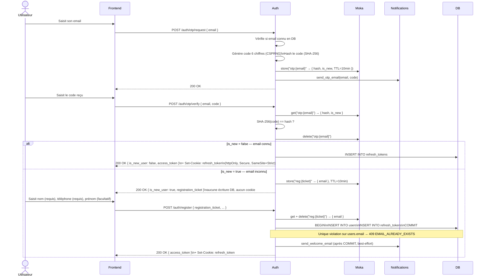

Le ticket est une preuve de possession de l'email, au même titre que l'access token : il ne quitte jamais l'état React côté frontend. Un rechargement pendant l'écran d'inscription le perd — sans conséquence en base, puisque aucun compte n'a été créé ; l'utilisateur redemande un code.

### 6.2 Demande et Validation du Rôle Owner

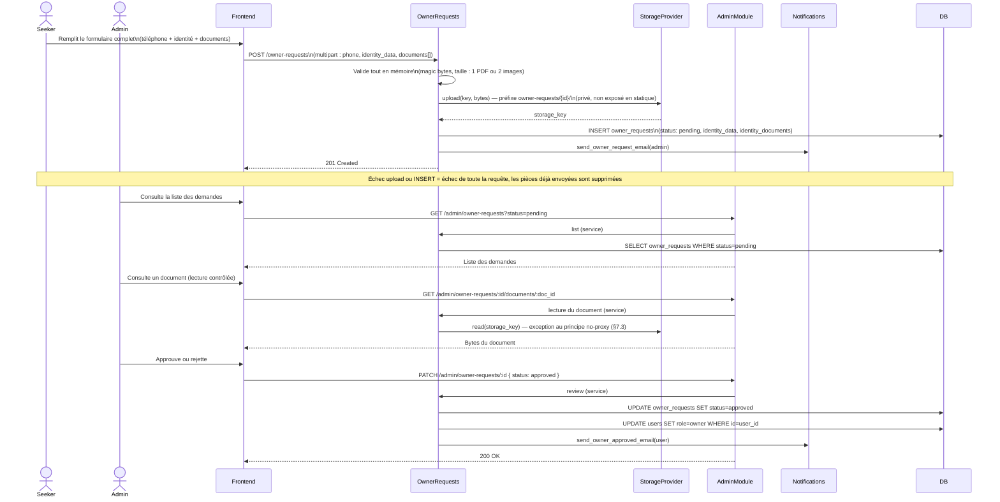

**Note — Admin unique au MVP :** un seul compte `admin` existe au MVP, créé par un script de bootstrap au démarrage (pas de self-service, pas d'endpoint de création d'admin). Il se connecte par e-mail + mot de passe (`POST /admin/auth/login`, haché Argon2id, verrouillage 15 min après 5 échecs) et non par OTP, que le backend lui refuse. Ce compte unique traite l'intégralité de la modération (biens, utilisateurs, demandes owner) depuis le back-office. Le modèle V2 introduira un rôle **superviseur** intermédiaire, notamment pour distribuer la charge de validation des demandes owner entre plusieurs opérateurs — hors périmètre MVP (cf. §11, R-09).

**Note — Rappel mensuel de disponibilité (LIST-03 du cahier des charges) :** le CDC prévoit qu'un owner dont un bien reste marqué `available` sans mise à jour depuis un mois reçoive un rappel automatique. Ce mécanisme est **différé en V2** : il nécessite soit une tâche planifiée in-process (`tokio::time::interval`), soit un déclencheur externe (cron), et un suivi de dernière notification par listing — aucune de ces briques n'existe au MVP. Documenté comme dette produit/technique en §11 (R-10).

### 6.3 Core Loop — Publication et Découverte d'un Bien

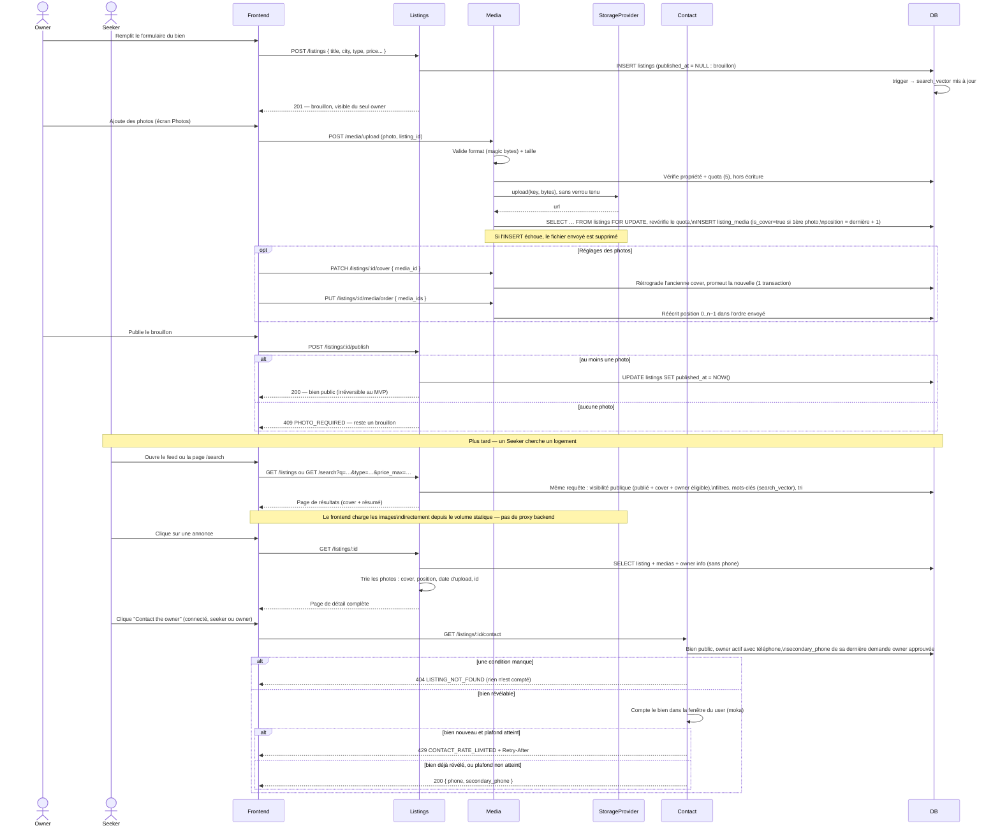

**Brouillon, photos, publication.** Un bien naît brouillon (`published_at` nul). Il reste invisible du public tant qu'il n'est pas publié et qu'il n'a pas au moins une photo ; seul son owner le voit, sur le détail comme dans `GET /users/me/listings`. Dans l'interface, la création mène au détail du brouillon, d'où l'owner ouvre l'écran Photos puis publie. La publication exige une photo et ne se défait pas au MVP : ensuite, l'owner ne joue plus que sur le statut `available` / `unavailable`, et le feed montre les deux.

**Ordre d'affichage des photos.** Toutes les lectures qui renvoient les photos d'un bien les trient de la même façon (`shared::media_order`) : la cover d'abord, puis `position` croissante, puis la date d'upload, puis `id`. Un upload prend la position qui suit la plus haute existante, même si des suppressions ont laissé des trous. Le réordonnancement réécrit les positions de 0 à n−1. L'écriture en base d'un upload, la suppression d'une photo ou du bien, le changement de cover et le réordonnancement prennent le même verrou sur la ligne `listings`, donc ils ne se croisent pas sur un même bien.

**Contact.** L'étape est livrée (MH-69) : le détail ne montre jamais de numéro, il faut le demander. Un visiteur anonyme voit « Sign in to contact », qui le ramène à l'annonce après connexion (MH-70). Un seeker ou un owner connecté obtient deux numéros : `phone`, le téléphone de son profil, et `secondary_phone`, le numéro secondaire de sa dernière demande owner approuvée, `null` s'il n'en a pas donné. La révélation exige que le bien soit visible publiquement, `available` ou `unavailable`, et que son owner soit actif et ait un téléphone de profil ; sinon la réponse est le même 404 qu'un id inconnu. Un admin reçoit un 403. Un plafond par utilisateur limite le nombre de biens distincts révélés par fenêtre (§8.8).

---

## 7. Vue Déploiement

### 7.1 Environnement Local (Développement)

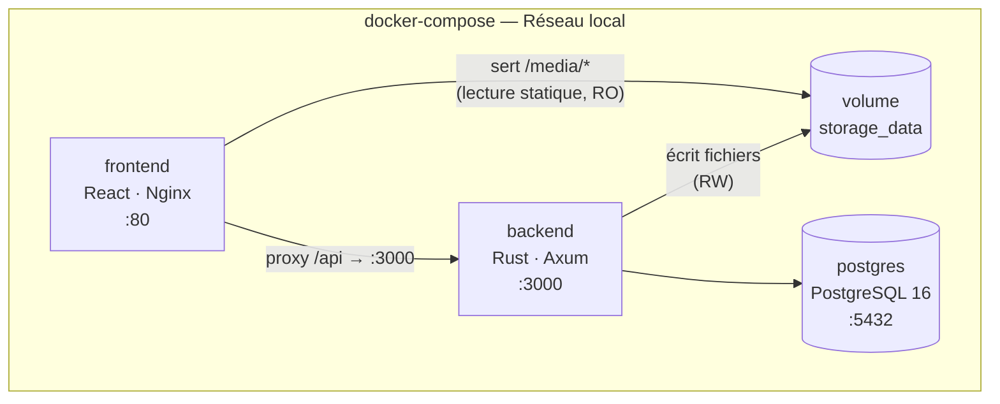

**Healthchecks :** postgres expose un healthcheck Docker natif. Le backend expose son propre endpoint `GET /health` (vérifie la connectivité PostgreSQL) utilisé comme healthcheck Docker. Le frontend ne démarre qu'après la disponibilité confirmée du backend.

**Exposition :** en dev, les ports ne sont publiés que sur `127.0.0.1`. Mailhog affiche les codes OTP, il ne doit pas être joignable depuis le réseau (cf. TECHNICAL_SPEC §7.4).

### 7.2 Environnement Production (Cible)

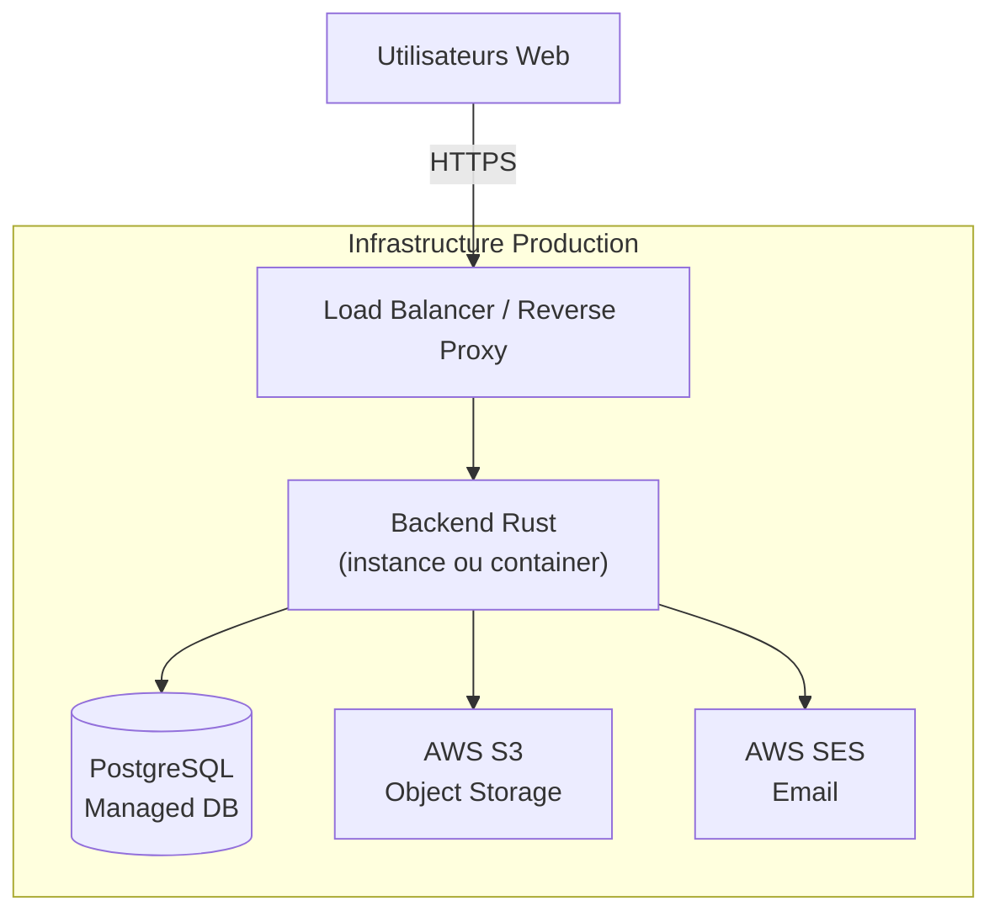

> Le détail de l'infrastructure production (cloud provider, orchestration, CI/CD) est hors périmètre de ce document — défini dans un document Infrastructure dédié.

> **Déploiement compose (MVP) :** nginx (`frontend-prod`) est le seul point d'entrée ; `backend-prod` et la base ne sont pas joignables depuis l'extérieur. TLS est terminé en amont de nginx, obligatoire puisque le cookie `refresh_token` est `Secure` (cf. TECHNICAL_SPEC §7.3).

> **Note MVP :** ce diagramme représente la cible V2. Si une mise en production a lieu avant la migration S3, le filesystem local (volume persistant monté sur l'instance backend) reste utilisable sans changement de code métier — seule la variable `STORAGE_PROVIDER` change au moment de la migration (cf. §7.3).

### 7.3 Abstraction Storage — Portabilité Dev/Prod

Les modules qui écrivent ou lisent des fichiers (`media`, `users`, `owner_requests`, et `listings` pour la suppression d'un bien) interagissent uniquement avec le trait `StorageProvider`. L'implémentation concrète est sélectionnée au démarrage via variable d'environnement :

```
STORAGE_PROVIDER=local  →  LocalFsStorage  (MVP — dev et prod)
STORAGE_PROVIDER=s3     →  AwsS3Storage    (V2 ; au MVP, la valeur est refusée au démarrage)
```

Aucun code métier n'est modifié lors de la migration V2 — seule l'implémentation concrète change.

**Principe — le backend ne proxie jamais la lecture des fichiers publics :** le frontend récupère les photos de listings et les avatars directement depuis l'URL stockée en base, servie en statique par nginx depuis le volume `storage_data` (jamais via un endpoint backend qui relit et retransmet les bytes). Ce principe élimine une charge inutile sur le backend et reste valable après la migration V2 (S3/CDN servent alors directement les URLs publiques).

`presigned_url` reste défini dans le trait `StorageProvider` pour garantir la compatibilité d'interface lors de la migration V2 (S3 imposera des URLs temporaires pour certains usages). Non implémenté pour `LocalFsStorage` au MVP — ce schéma de stockage n'a pas besoin d'URLs signées puisque les fichiers publics sont servis en statique sans contrôle d'accès.

**Exception documentée — documents d'identité (`owner_requests`) :** contrairement aux photos publiques, les documents d'identité soumis lors d'une demande owner sont des données sensibles à accès restreint (admin uniquement). Ils sont stockés sous un préfixe dédié (`owner-requests/{request_id}/`) **non exposé** par la configuration statique nginx. Leur lecture passe donc obligatoirement par un endpoint backend authentifié et contrôlé par rôle (`GET /admin/owner-requests/:id/documents/:doc_id`), qui appelle `StorageProvider::read()` après vérification d'autorisation. C'est la seule exception au principe no-proxy ci-dessus, justifiée par un besoin de contrôle d'accès qu'un serveur de fichiers statique ne peut pas assurer.

---

## 8. Concepts Transverses

### 8.1 Authentification et Autorisation

| Concept                    | Détail                                                                                                                                                                                                                                                                                                                                          |
| -------------------------- | ------------------------------------------------------------------------------------------------------------------------------------------------------------------------------------------------------------------------------------------------------------------------------------------------------------------------------------------------ |
| Mécanisme                 | OTP Passwordless — email uniquement                                                                                                                                                                                                                                                                                                             |
| Tokens                     | JWT access token (15 min) + refresh token (fenêtre glissante 30 jours, rotation à chaque usage)                                                                                                                                                                                                                                                |
| Refresh token — transport | Cookie`httpOnly`, `Secure`, `SameSite=Strict` — jamais exposé en JSON au frontend                                                                                                                                                                                                                                                        |
| Refresh token — rotation  | Chaque appel`/auth/refresh` révoque l'ancien token et en émet un nouveau. Réutilisation d'un token déjà consommé = signal de vol → révocation de toute la famille de tokens liés. Chaque rotation purge les tokens du compte expirés depuis plus de 30 jours                                                                                                                                                      |
| OTP                        | Code 6 chiffres, CSPRNG, hashé SHA-256, stocké dans moka (TTL 10 min, usage unique)                                                                                                                                                                                                                                                            |
| Rate limiting              | 3 essais par code. Entre deux demandes OTP pour une adresse : 60 s, doublé pour chaque code dont les essais sont épuisés, jusqu'à 5 min. Le compteur d'essais est gardé 24 h et repart à zéro au premier code correct. Limite générique par IP en plus, une adresse IPv6 comptant pour son /64 |
| Autorisation               | Rôles portés dans le JWT claims — vérifiés par extracteur Axum sur chaque route protégée. Le rôle n'est pas relu en base avant le prochain refresh (R-14) |
| Compte actif               | `is_active` revérifié par l'extracteur `AuthUser` sur **chaque** requête authentifiée (pas seulement au login), via un cache moka de 8 secondes. Une suspension, une réactivation ou une suppression, par l'admin ou par l'utilisateur lui-même, invalide cette entrée : elle prend effet immédiatement, y compris sur une session déjà active |
| Compte admin               | **Un seul compte `admin` au MVP**, créé par un script de bootstrap (variables d'environnement `ADMIN_BOOTSTRAP_EMAIL` / `ADMIN_BOOTSTRAP_PASSWORD`, ou commande CLI dédiée) au déploiement initial — aucune route d'auto-inscription ou de promotion vers `admin` n'existe. Le rôle `admin` n'est jamais atteignable via `POST /owner-requests` ni via aucun endpoint utilisateur |

**Modèle de rôles et transitions :**

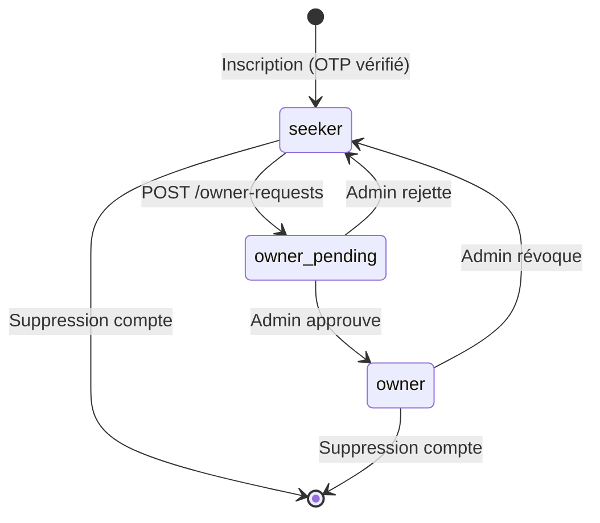

`owner_pending` n'est pas un rôle stocké : c'est un seeker dont une demande est `pending`. La suspension n'apparaît pas dans ce diagramme parce qu'elle ne change pas le rôle : elle porte sur `is_active`, et un seeker comme un owner peuvent être suspendus. Aucune action de modération (suspension, suppression, retrait de rôle) ne peut viser un compte admin (`403 ADMIN_ACCOUNT_PROTECTED`).

**Suspension et réactivation** (`PATCH /admin/users/:id`) :

| Aspect | Comportement |
| ------ | ------------ |
| Connexion | `/auth/otp/verify` refuse le compte avec `401 ACCOUNT_SUSPENDED`, une fois le code prouvé : sans accès à la boîte mail, on ne peut pas savoir qu'un compte est suspendu |
| Refresh | `/auth/refresh` répond `401 ACCOUNT_SUSPENDED` avant les contrôles de révocation et d'expiration, et efface le cookie. La fenêtre de grâce de la rotation n'émet rien |
| Sessions ouvertes | L'entrée `is_active` du cache est invalidée : la requête suivante reçoit `401 ACCOUNT_SUSPENDED`, et le frontend déconnecte la personne en affichant le motif |
| Biens | Ceux d'un owner suspendu quittent le feed, la recherche, le détail et la révélation du contact. Ils ne sont pas modifiés et apparaissent `hidden` dans `/admin/listings` |
| Réactivation | Les biens redeviennent publics, inchangés. Tous les refresh tokens du compte sont supprimés : les anciennes sessions restent fermées et il faut se reconnecter par OTP. Seul un access token émis avant la suspension redevient valable jusqu'à son expiration (15 min au plus) |

**Retrait du rôle owner** (`POST /admin/users/:id/revoke-owner`, transition `owner --> seeker`) :

| Aspect | Comportement |
| ------ | ------------ |
| Rôle | `users.role` repasse à `seeker`, que le compte soit actif ou suspendu. Une cible qui n'a pas le rôle `owner` reçoit `409 NOT_AN_OWNER`. Le JWT déjà émis garde le rôle `owner` jusqu'à son expiration ou au prochain refresh (R-14) |
| Biens | Aucune ligne `listings` ou `listing_media` n'est modifiée. La règle de visibilité les retire de la vue publique, et l'ancien owner ne peut plus ouvrir leur détail, même avec un jeton encore porteur du rôle `owner`. Ce qu'il crée ou publie pendant le délai de R-14 reste masqué |
| Nouvelle demande | Redevenu seeker, le compte peut refaire `POST /owner-requests` (transition `seeker --> owner_pending`). Une demande `pending` au moment du retrait est conservée et bloque une nouvelle soumission. Une nouvelle approbation rend les biens publics, inchangés, et le `secondary_phone` exposé est celui de cette dernière demande |

Les deux décisions masquent les biens sans toucher au storage : les photos restent accessibles à qui possède leur URL directe, puisque nginx les sert sans passer par le backend. La règle exigeant `role = 'owner'`, les biens d'un owner promu admin par le bootstrap sont aussi masqués ; ce cas ne se présente qu'au démarrage sans admin existant.

**Suppression de compte :** la cascade SQL (`ON DELETE CASCADE`) supprime les lignes liées (listings, listing_media, owner_requests, refresh_tokens), mais ne touche jamais le storage physique. Le service supprime donc les fichiers lui-même, dans une transaction : il verrouille la ligne `users` et les biens du compte (`FOR UPDATE`), relit l'avatar, liste les clés des photos et des pièces d'identité, appelle `StorageProvider::delete()` pour chacune, exécute le `DELETE` SQL puis commite. Un upload concurrent attend ce verrou, trouve ensuite le compte ou le bien supprimé et efface le fichier qu'il vient d'écrire. La transaction garde une connexion du pool pendant la suppression des fichiers, ce qui est accepté au MVP. `DELETE /users/me` et `DELETE /admin/users/:id` suivent ce chemin et invalident l'entrée `is_active` du cache pour clore la session ouverte ; la route admin refuse un compte admin.

**Suppression d'un bien ou d'une photo :** l'ordre est inversé. Le `DELETE` SQL est commité d'abord, puis les fichiers sont supprimés en best-effort. Une panne du storage ne peut laisser qu'un fichier orphelin : aucune ligne ne pointe vers un fichier absent.

### 8.2 Gestion des Erreurs

Toutes les erreurs convergent vers un type `AppError` centralisé, converti en réponse HTTP structurée uniforme :

```json
{
  "error": {
    "code": "LISTING_NOT_FOUND",
    "message": "Le bien demandé n'existe pas.",
    "status": 404
  }
}
```

Les rejets des extracteurs (`AppJson`, `AppQuery`, `AppPath`) passent aussi par `AppError` et gardent cette enveloppe.

### 8.3 Pagination

Standard appliqué sur tous les endpoints de liste :

```json
{
  "data": [...],
  "pagination": {
    "page": 1,
    "per_page": 30,
    "total": 143,
    "total_pages": 8
  }
}
```

### 8.4 Logging

Structured logging via `tracing` (écosystème Tokio). Format JSON en production, format lisible en développement. Niveau configurable via `RUST_LOG`.

Les adresses e-mail sont masquées dans les logs (`shared::pii`). Un `X-Request-Id` reçu n'est repris que s'il compte 1 à 64 caractères parmi `[A-Za-z0-9_-]` ; sinon le serveur génère un UUID.

### 8.5 Configuration

Variables d'environnement exclusivement — 12-factor app. Chargées au démarrage dans une struct `AppConfig` validée. Aucun fichier de configuration en production.

### 8.6 Génération des Types TypeScript

```
Backend (utoipa) → /api/docs/openapi.json → openapi-typescript → src/shared/api/types.ts
```

Le schéma OpenAPI est la source de vérité unique du contrat API. Les types TypeScript sont générés, jamais écrits manuellement. Le backend ne sert `/api/docs` qu'en `development` ; la CI génère les types depuis `frontend/docs-frontend/openapi.json`.

### 8.7 Health Check et Arrêt Propre (Graceful Shutdown)

| Concept           | Détail                                                                                                                                                                                                                            |
| ----------------- | ---------------------------------------------------------------------------------------------------------------------------------------------------------------------------------------------------------------------------------- |
| `GET /health`   | Endpoint non-authentifié, hors`/api/v1`. Vérifie la connectivité PostgreSQL (`SELECT 1`). Retourne `200` si prêt, `503` sinon. Utilisé comme healthcheck Docker et comme readiness probe pour un futur orchestrateur. |
| Graceful shutdown | Le serveur intercepte `SIGINT` et `SIGTERM` : il arrête d'accepter des connexions, laisse les requêtes en vol se terminer pendant 30 s au plus, puis quitte. Évite les requêtes coupées lors d'un redéploiement sans qu'une connexion lente bloque l'arrêt. |
| Délais | Les en-têtes doivent arriver en 30 s. Un corps qui n'envoie plus rien pendant 30 s est coupé ; un upload lent mais continu passe. Une requête dure 10 minutes au plus (`408 REQUEST_TIMEOUT`). |

### 8.8 Protection des Coordonnées des Owners

Le téléphone d'un owner n'apparaît dans aucune réponse publique (feed, recherche, détail) : seul `GET /listings/:id/contact` le renvoie, à un seeker ou un owner connecté. Sans limite, un seul compte pourrait collecter le numéro de tous les owners de la plateforme, et la limite générique par IP ne fait que ralentir cette collecte.

Chaque utilisateur peut donc révéler les numéros de `CONTACT_REVEAL_MAX_PER_WINDOW` biens distincts par fenêtre fixe de `CONTACT_REVEAL_WINDOW_SECONDS` (30 par 8 heures par défaut) : un seeker réel ne le remarque pas, et la collecte en masse reste coûteuse. La fenêtre s'ouvre à la première révélation comptée. Le compte est par `user_id`, pas par IP, donc deux utilisateurs derrière la même IP (NAT d'opérateur mobile, cybercafé) ne se gênent pas. Revoir un bien déjà révélé dans la fenêtre ne compte pas et reste possible une fois le plafond atteint, car ce numéro est déjà connu de l'utilisateur. Au-delà, un nouveau bien reçoit `429 CONTACT_RATE_LIMITED` avec un en-tête `Retry-After` qui donne les secondes restantes dans la fenêtre, et chaque refus est journalisé avec le `user_id`.

Le plafond s'applique après la lecture en base, donc un 404 ne compte pas et n'ouvre pas de fenêtre. Il ne freine donc pas le balayage d'ids : c'est accepté, car les ids de biens sont des UUID aléatoires et la limite générique par IP s'applique toujours. Chaque fenêtre garde les ids des biens révélés dans moka, avec un plafond sur le nombre d'entrées, et les appels concurrents d'un même utilisateur partagent la même fenêtre (cf. R-12).

---

## 9. Décisions d'Architecture

| ID     | Décision                                                            | Alternatives écartées                               | Raison                                                                                                                                                                       |
| ------ | -------------------------------------------------------------------- | ----------------------------------------------------- | ---------------------------------------------------------------------------------------------------------------------------------------------------------------------------- |
| ADR-01 | **Modular Monolith**                                           | Microservices                                         | Overhead non justifié à l'échelle cible (< 100K users)                                                                                                                    |
| ADR-02 | **OTP Passwordless**                                           | Email + password, OAuth                               | Simplifie l'auth, supprime la gestion des mots de passe, surface d'attaque réduite                                                                                          |
| ADR-03 | **PostgreSQL full-text**                                       | Meilisearch, Elasticsearch                            | Suffisant pour le MVP, pas de dépendance externe supplémentaire                                                                                                            |
| ADR-04 | **moka (in-memory)**                                           | Redis                                                 | OTP est éphémère — Redis non justifié au MVP                                                                                                                            |
| ADR-05 | **Trait StorageProvider + LocalFsStorage au MVP**              | MinIO/S3 dès le MVP                                  | Filesystem local (volume Docker) suffisant à l'échelle MVP, simplicité maximale ; le trait garantit la migration vers S3-compatible (V2) sans refactoring du code métier |
| ADR-06 | **utoipa + openapi-typescript**                                | Écriture manuelle des types TS                       | Single source of truth — cohérence garantie entre backend et frontend                                                                                                      |
| ADR-07 | **Rôle `seeker` par défaut**                               | Choix de rôle à l'inscription                       | Friction minimale à l'entrée — upgrade owner en self-service validé par admin                                                                                            |
| ADR-08 | **Un seul endpoint OTP**                                       | Endpoints login/register séparés                    | Simplifie le flux client —`is_new_user` gère le routage côté frontend                                                                                                  |
| ADR-11 | **Inscription atomique via `POST /auth/register` + ticket opaque** | Création du compte dès `/auth/otp/verify`, complété ensuite par `PUT /users/me` | L'ancien flux laissait un compte fantôme (email seul, authentifiable) si l'utilisateur abandonnait entre les deux appels. `users` + `refresh_tokens` sont désormais insérés dans une seule transaction, tous champs obligatoires présents ; le ticket (usage unique, TTL 10 min) porte la preuve de possession de l'email entre les deux appels |
| ADR-09 | **Rotation du refresh token à chaque usage**                  | Refresh token statique valable 30 jours sans rotation | Détection de vol (réutilisation d'un token déjà consommé) et révocation immédiate de la famille de tokens ; le TTL 30 jours reste un plafond indépendant             |
| ADR-10 | **Refresh token en cookie `httpOnly` + `SameSite=Strict`** | Refresh token retourné en JSON body                  | Protection contre le vol via XSS (non accessible en JS) ;`SameSite=Strict` neutralise le CSRF sans token dédié, suffisant pour un MVP mono-domaine                       |
| ADR-12 | **Recherche hébergée dans le module `listings`** (`GET /search`, MH-64) | Module `search` séparé, avec son handler, son service et son repository | La recherche lit les mêmes lignes que le feed, avec la même règle de visibilité (TECHNICAL_SPEC §4.3) et les mêmes filtres. Feed et recherche partagent donc `ListingFilters` et une seule paire de requêtes (comptage + page) : `total` reste aligné sur les pages, et une règle ne peut pas diverger entre les deux. Un module séparé aurait dû dupliquer ces requêtes ou importer le repository de `listings`, ce que la règle de dépendance (§5.3) interdit. Conséquence : une extraction vers un moteur dédié (R-02) passera par un découpage de `listings::repository`, pas par le remplacement d'un module |
| ADR-13 | **Routes admin de modération hébergées dans le module qui possède les données** (`/admin/listings*` dans `listings`, `/admin/users*` dans `users`, MH-72 à MH-75) | Module `admin` avec ses propres requêtes sur `listings` et `users` ; module `admin` déléguant aux services de ces modules | Même raisonnement que ADR-12 : la liste admin réutilise les filtres et le fragment SQL de visibilité du feed, la suppression d'un bien réutilise le verrou et le nettoyage du storage, la suppression d'un compte celui de `users`. Un module `admin` séparé aurait dû dupliquer ces règles, au risque de les voir diverger, ou importer les modules concernés, ce qui aurait étendu l'écart suivi en R-11. Conséquences : le préfixe `/admin/*` ne désigne pas un module, le contrôle du rôle reste dans chaque handler (`require_role`), le tag OpenAPI `admin` regroupe les routes, et le module `admin` ne porte plus que les demandes owner |

---

## 10. Exigences de Qualité

### 10.1 Objectifs et Scénarios

| Qualité                  | Scénario                                    | Cible                                                  |
| ------------------------- | -------------------------------------------- | ------------------------------------------------------ |
| **Performance**     | Recherche full-text avec filtres             | < 500ms (P95)                                          |
| **Performance**     | Chargement du feed (20 items + cover photos) | < 2s                                                   |
| **Disponibilité**  | Uptime de la plateforme                      | 99.5%                                                  |
| **Sécurité**      | Tentatives de brute-force sur OTP            | 3 essais par code ; 60 s entre demandes, doublé par code épuisé jusqu'à 5 min |
| **Scalabilité**    | Passage de 10K à 100K utilisateurs          | Sans refactoring architectural                         |
| **Maintenabilité** | Ajout d'un nouveau module de domaine         | Sans modifier les modules existants                    |

### 10.2 Arbre de Qualité

```
Qualité Système
├── Fiabilité
│   ├── Disponibilité 99.5%
│   └── Cohérence des données (ACID PostgreSQL)
├── Sécurité
│   ├── Authentification OTP + JWT
│   ├── Protection données contact (phone révélé uniquement aux users connectés)
│   └── Rate limiting sur endpoints sensibles
├── Performance
│   ├── Search < 500ms (GIN index + tsvector)
│   └── Feed < 2s (cover photo + pagination)
├── Maintenabilité
│   ├── Frontières de modules respectées
│   ├── Tests unitaires et d'intégration, couverture ≥ 90 % des lignes
│   └── Contrat API typé (utoipa)
└── Évolutivité
    ├── Extraction microservice possible sans refactoring
    └── Swap Redis / moka via trait
```

### 10.3 Stratégie de Tests

Les tests unitaires vivent dans chaque fichier backend et couvrent la logique qui ne touche pas la base. Aucun repository n'est mocké : ce sont des fonctions sur `PgPool`, sans trait, et ce qui dépend de la base se teste en intégration.

Les tests d'intégration (`backend/tests/integration/`, feature `integration`) passent par le vrai router avec une base PostgreSQL propre à chaque test, créée et migrée par `#[sqlx::test]`. Une transaction rollbackée ne pourrait pas isoler les tests, car le code applicatif committe ses propres transactions. Chaque ticket de flux de l'EP-14 a livré un fichier de test.

La CI mesure les deux niveaux ensemble et échoue sous 90 % de lignes couvertes. Le détail par couche, les cas critiques et leurs fichiers de test, et la procédure locale sont dans TECHNICAL_SPEC §6.

---

## 11. Risques et Dette Technique

| ID   | Risque                                                                                                                                                                                                           | Probabilité                   | Impact                                           | Mitigation                                                                                                                          |
| ---- | ---------------------------------------------------------------------------------------------------------------------------------------------------------------------------------------------------------------- | ------------------------------ | ------------------------------------------------ | ----------------------------------------------------------------------------------------------------------------------------------- |
| R-01 | **moka non partageable** entre instances backend                                                                                                                                                           | Faible (MVP mono-instance)     | Élevé si scaling horizontal                    | Remplacer par Redis via le trait — changement localisé à`infra/cache.rs`                                                       |
| R-02 | **Full-text PostgreSQL insuffisant** pour recherche avancée (floue, multilingue)                                                                                                                          | Moyenne                        | Moyen                                            | Extraire la requête de recherche de `listings::repository` derrière un trait, puis brancher Meilisearch (cf. ADR-12)          |
| R-03 | **Délivrabilité email OTP** (spam, délai)                                                                                                                                                               | Moyenne                        | Élevé                                          | Dès la production, passer par un relais SMTP réputé, authentifié et chiffré (STARTTLS/TLS), pris en charge au MVP via `SMTP_USERNAME`/`SMTP_PASSWORD`/`SMTP_SECURITY` (MH-113). Le relais se change par variables d'environnement, sans code propre à un fournisseur. SDK et API transactionnelles HTTP (SES, Postmark) restent hors scope MVP (cf. TECHNICAL_SPEC §3bis.3) |
| R-04 | **Validation owner manuelle** non scalable                                                                                                                                                                 | Faible (MVP)                   | Moyen                                            | Back-office admin V2 avec workflow de validation automatisé                                                                        |
| R-05 | **Charge pics sur le feed** (images lourdes)                                                                                                                                                               | Faible                         | Moyen                                            | CDN devant S3 en V2, lazy loading côté frontend dès le MVP                                                                       |
| R-06 | **Storage filesystem non partagé** entre instances backend (volume local au conteneur)                                                                                                                    | Faible (MVP mono-instance)     | Élevé si scaling horizontal                    | Migration vers S3-compatible via le trait`StorageProvider` — changement localisé à `infra/storage/`, déjà prévu en V2     |
| R-07 | **Absence d'index sur `listings.price`** alors que `price_min`/`price_max` sont des filtres actifs                                                                                                   | Faible au volume MVP           | Faible                                           | Ajouter un index B-tree sur`price` si le volume de listings augmente significativement                                            |
| R-08 | **Trigger `fn_update_listing_search_vector` exécute un `SELECT` sur `users` par ligne** modifiée — un changement de nom d'owner avec N listings déclenche N requêtes dans le trigger de cascade | Faible au volume MVP           | Faible                                           | Acceptable au MVP ; à revisiter (dénormalisation ou recalcul batch) si le volume de listings par owner augmente significativement |
| R-09 | **Un seul compte admin** — aucune redondance opérationnelle ; indisponibilité de l'admin bloque toute validation owner et toute modération                                                             | Faible (MVP, équipe réduite) | Moyen                                            | Rôle superviseur (charge de validation distribuée) prévu en V2                                                                   |
| R-10 | **Rappel mensuel de disponibilité (LIST-03 du CDC) non implémenté au MVP** — exigence `Must` du cahier des charges différée faute de mécanisme de tâche planifiée                               | Certaine (déjà connu)        | Faible produit / Moyen conformité contractuelle | Implémenter en V2 via tâche planifiée in-process ou cron externe ; amendement explicite du CDC en attendant (cf. CDC v2.1 §6.3) |
| R-11 | **Règle de dépendance inter-modules non respectée partout** (§5.3) : `owner_requests` appelle `users::service`, `admin` appelle `owner_requests::service`, `auth` et `owner_requests` appellent `notifications` directement, `contact` importe `listings::repository::push_public_visibility` et `shared::extractors` importe `users::repository::find_is_active`, sans trait dans `shared/` | Certaine (déjà dans le code) | Faible au MVP / Moyen si un module est extrait | Introduire les traits de service dans `shared/` et l'injection au bootstrap avant toute extraction de module ; d'ici là, ne pas ajouter de nouvel import direct |
| R-12 | **Compte des révélations du contact en mémoire** (§8.8) : il repart de zéro à chaque redémarrage du backend et n'est pas partagé entre instances, donc un utilisateur peut dépasser le plafond en profitant d'un redéploiement ou de plusieurs instances | Faible (MVP mono-instance, redémarrages rares) | Faible au MVP / Moyen si scaling horizontal | Même mitigation que R-01 : passer le cache sur Redis via le trait `AppCacheProvider`, sans toucher au module `contact` |
| R-13 | **Numéro secondaire non modifiable** : `secondary_phone` est saisi dans la demande owner et aucune route ne le change après approbation ; un owner qui change de numéro secondaire continue d'exposer l'ancien | Moyenne | Faible produit / Moyen confiance des seekers | Ajouter la modification du numéro secondaire au profil owner (V2) ; d'ici là, le téléphone de profil reste modifiable via `PUT /users/me` |
| R-14 | **Retrait du rôle owner appliqué avec jusqu'à 15 minutes de délai** : le rôle est porté par le JWT et `AuthUser` relit `is_active`, pas `role`. Jusqu'à l'expiration de l'access token (15 min au plus) ou au prochain refresh, la personne garde les droits owner sur l'API. Ses écritures aboutissent et répondent normalement, mais restent masquées | Certaine à chaque retrait de rôle | Faible : ses biens sont déjà masqués, et ce qu'elle crée ou publie pendant le délai reste masqué par la règle de visibilité | Accepté au MVP. Si le délai devient gênant, relire le rôle dans `AuthUser` sur le modèle de `is_active` (cache court invalidé par l'action admin) |

---

## 12. Glossaire

| Terme                      | Définition                                                                                                                                                                                                                                  |
| -------------------------- | -------------------------------------------------------------------------------------------------------------------------------------------------------------------------------------------------------------------------------------------- |
| **Owner**            | Utilisateur ayant obtenu le rôle propriétaire après validation admin. Peut publier des biens.                                                                                                                                             |
| **Seeker**           | Rôle par défaut à l'inscription. Peut naviguer, rechercher, et contacter un owner.                                                                                                                                                        |
| **Admin**            | Opérateur interne. Modère la plateforme et valide les demandes owner.                                                                                                                                                                      |
| **OTP**              | One-Time Password — code à 6 chiffres envoyé par email, valable 10 minutes, usage unique.                                                                                                                                                 |
| **Listing**          | Annonce immobilière publiée par un owner (bien, description, photos, localisation, prix).                                                                                                                                                  |
| **Cover photo**      | Photo mise en avant d'un listing, affichée dans le feed public. Sélectionnée automatiquement à la première photo uploadée sur le listing ; modifiable ensuite par l'owner parmi les photos existantes (`PATCH /listings/:id/cover`). |
| **Feed**             | Page d'accueil présentant les annonces sous forme de grille de cover photos scrollable.                                                                                                                                                     |
| **StorageProvider**  | Trait Rust abstraisant le stockage fichiers — implémenté par`LocalFsStorage` (MVP) et `AwsS3Storage` (V2).                                                                                                                            |
| **LocalFsStorage**   | Implémentation`StorageProvider` au MVP — écrit sur un volume Docker local, servi en statique par nginx.                                                                                                                                 |
| **moka**             | Bibliothèque Rust de cache in-memory avec support TTL natif. Utilisée pour les OTP.                                                                                                                                                        |
| **search_vector**    | Colonne PostgreSQL de type`tsvector` utilisée pour la recherche full-text sur les listings.                                                                                                                                               |
| **ADR**              | Architecture Decision Record — document court capturant une décision architecturale et sa justification.                                                                                                                                   |
| **Modular Monolith** | Pattern architectural : un seul binaire déployé, structuré en modules aux frontières strictes.                                                                                                                                           |

---

## Historique des Révisions

| Version | Date          | Description |
| ------- | ------------- | ----------- |
| 1.2     | Août 2026     | Dernière version publiée sans historique de révisions |
| 1.3     | Novembre 2026 | MH-68, alignement sur le code après EP-09 et EP-10. §5.2/§5.3 : recherche hébergée dans `listings`, module `owner_requests`, dépendances réelles et tables partagées. §6.2 : la demande owner passe par `owner_requests`, sans `media`. §6.3 : parcours owner brouillon → photos → publication, ordre d'affichage des photos (cover d'abord), feed et recherche sur la même requête. §9 : ADR-12 (recherche dans `listings`). §11 : R-02 reformulé, R-11 ajouté. Numéro de version aligné sur l'en-tête (1.x), fichier renommé sans numéro de version |
| 1.4     | Novembre 2026 | MH-71, livraison de l'EP-11 (Contact). §6.3 : étape contact livrée, deux numéros (`phone`, `secondary_phone`), conditions de révélation, retour à l'annonce après connexion. §8.8 : plafond de révélations par utilisateur comme protection des coordonnées des owners. §11 : R-12 (compteur en mémoire) et R-13 (numéro secondaire non modifiable) ajoutés |
| 1.5     | Novembre 2026 | MH-71 (#208), plafond de révélations aligné sur la règle retenue. §5.2 : module `contact` livré. §6.3 : lecture en base avant le comptage. §8.8 : 30 biens distincts par 8 h, un bien déjà révélé ne compte pas, un 404 n'ouvre pas de fenêtre, balayage d'ids accepté. §11 : R-12 reformulé |
| 1.6     | Novembre 2026 | MH-76, livraison de l'EP-12 (modération admin). §5.2 : le module `admin` ne porte que les demandes owner, routes de modération dans `listings` et `users`. §5.3 : tables partagées mises à jour, dépendances réelles de `contact`, écarts complétés. §6.3 : visibilité publique avec owner éligible. §8.1 : cache `is_active`, suspension (connexion, refresh, sessions ouvertes, biens) et retrait du rôle owner (rôle, biens, nouvelle demande), suppression d'un compte par l'admin. §9 : ADR-13 (routes admin dans le module qui possède les données), ADR-12 renvoie à la règle de visibilité. §11 : R-14 (délai du retrait de rôle) ajouté, R-11 complété |
| 1.7     | Novembre 2026 | MH-77, corrections de l'audit de sécurité du 12 novembre 2026. §7.1 et §7.2 : ports de dev en loopback, nginx seul point d'entrée en production, TLS en amont. §7.3 : `STORAGE_PROVIDER=s3` refusé au démarrage. §8.1 : délai OTP croissant, limite IPv6 par /64, purge des refresh tokens expirés, suppression de compte sous verrou, invalidation du cache `is_active` sur `DELETE /users/me`. §8.2 : enveloppe d'erreur pour les rejets d'extracteurs. §8.4 : e-mails masqués, `X-Request-Id` borné. §8.6 : Swagger UI en `development` seulement. §8.7 : délais du serveur et arrêt borné à 30 s. §10.1 : scénario brute-force OTP |
| 1.8     | Novembre 2026 | MH-85, stratégie de tests alignée sur la suite livrée par l'EP-14. §10.2 : tests unitaires et d'intégration, seuil de couverture à 90 % des lignes. §10.3 : stratégie de tests ajoutée (pas de repository mocké, une base par test d'intégration, seuil appliqué en CI) |
